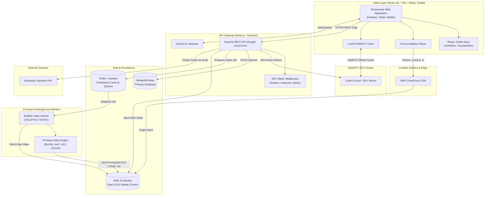
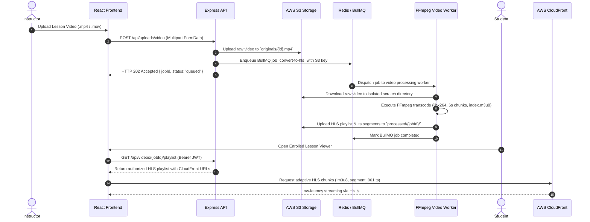
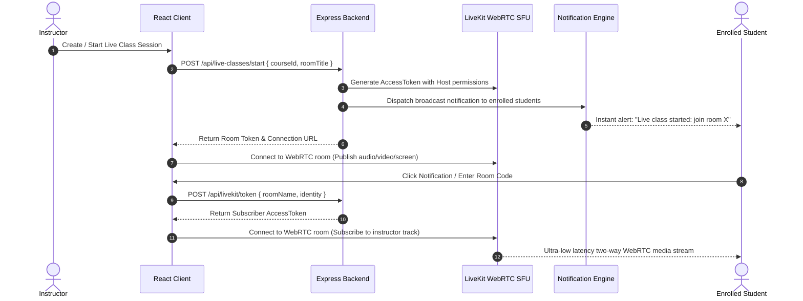

# LearnLive – Enterprise Learning Management System with Live Classes

[](https://github.com/navi-siddu-1103/learning-management-system-live-classes)
[](https://github.com/navi-siddu-1103/learning-management-system-live-classes)
[](https://livekit.io)
[](https://ffmpeg.org)
[](https://aws.amazon.com)
[](https://bullmq.io)
[](https://redux-toolkit.js.org)
[](https://learning-management-system-live-cla.vercel.app)

> **Submission Project**: FS-03 Project #1 of 2 – *Learning Management System with Live Classes*  
> **Repository**: [https://github.com/navi-siddu-1103/learning-management-system-live-classes](https://github.com/navi-siddu-1103/learning-management-system-live-classes)  
> **Production Frontend**: [https://learning-management-system-live-cla.vercel.app](https://learning-management-system-live-cla.vercel.app)  
> **Production API**: [https://learning-management-system-live-classes-753172578941.asia-south1.run.app/api](https://learning-management-system-live-classes-753172578941.asia-south1.run.app/api)

---

## 📋 Executive Overview

**LearnLive** is a production-grade, enterprise-ready Learning Management System (LMS) engineered to power modern digital academies. It provides a complete end-to-end educational ecosystem where instructors author rich media courses, upload high-definition video curriculum, host real-time interactive WebRTC live classrooms, and administer assessments, while students enjoy adaptive video streaming, live attendance, interactive quizzes, automated grading, and cryptographically verifiable PDF certificates.

The platform is designed around a high-throughput, microservices-ready architecture: compute-heavy video ingestion is decoupled from the HTTP API via **BullMQ** and **Redis**, transcoded into multi-resolution **HLS (HTTP Live Streaming)** using **FFmpeg**, stored in **AWS S3**, and delivered via **AWS CloudFront** edge caching. Real-time live classes leverage **WebRTC (LiveKit SFU)** for ultra-low-latency two-way audio/video and screen sharing.

---

## 🎯 Hiring Assignment Requirements & Tech Stack Alignment

This project was built strictly adhering to the requirements outlined in the **Full-Stack Development Specialization Track (FS-03 Project #1 of 2)** evaluation rubric:

| Evaluator Requirement | Implementation in LearnLive | Verification in Codebase |
|---|---|---|
| **1. MERN Stack** | Full-stack application powered by **MongoDB**, **Express.js**, **React 18** (Vite), and **Node.js** with RESTful architecture, schema validation, and JWT RBAC authentication. | `client/src/App.jsx`, `server/src/index.js`, `server/src/models.js` |
| **2. WebRTC** | Real-time interactive virtual classrooms with video, audio, screen-sharing, speaker detection, and automatic room broadcast notifications via **LiveKit WebRTC SFU**. | Backend: `server/src/routes/livekit.js`, Frontend: `@livekit/components-react` in `client/src/pages/LiveClassRoom.jsx` |
| **3. FFmpeg** | Asynchronous video processing worker transforming raw MP4/MOV/WebM video uploads into HLS playlists (`.m3u8`) and segmented video chunks (`.ts`) for adaptive bitrate streaming. | `server/src/workers/videoWorker.js` (spawn `ffmpeg` child process with `libx264` + `aac` HLS encoding) |
| **4. AWS CloudFront & S3** | Cloud object storage for original uploads and processed HLS segments via `@aws-sdk/client-s3`, backed by CloudFront CDN for global low-latency video streaming. | S3 integration in `server/src/workers/videoWorker.js`, `server/src/routes/videos.js`, and `server/src/routes/uploads.js` |
| **5. BullMQ & Redis** | Distributed background task queue with concurrency controls, exponential backoff retries, and job status tracking to decouple heavy video transcoding from the main API. | `server/src/queues/videoQueue.js`, `server/src/redis.js`, `server/src/workers/videoWorker.js` |
| **6. Redux Toolkit** | Centralized client-side state store using `@reduxjs/toolkit` and `react-redux` managing authentication sessions (`authSlice`), course catalog (`coursesSlice`), and persistent storage sync. | `client/src/store/index.js`, `client/src/store/authSlice.js`, `client/src/store/coursesSlice.js`, `client/src/main.jsx` |

### Auxiliary Technologies
- **PDFKit**: Server-side programmatic generation of high-resolution, branded, executive completion certificates with verification hashes.
- **Razorpay**: Integrated payment gateway with HMAC-SHA256 signature verification for course checkout and instructor payouts.
- **Socket.IO**: Real-time bi-directional events for platform notifications and instant live class alerts.
- **Lucide React**: Modern, consistent iconography across all interface panels.
- **Docker & Cloud Run**: Containerized backend services with separate API and video worker deployment profiles.

---

## 🏛️ System Architecture

### High-Level Architecture



---

## 🔄 Core Workflows

### 1. Asynchronous Video Ingestion & HLS Transcoding Pipeline



### 2. WebRTC Live Class Session & Broadcast Flow



---

## 🌟 Key Features & Module Capabilities

### 👨‍🎓 Student Portal
- **Course Discovery & Enrollment**: Dynamic catalog browsing with categories, level filtering, instructor profiles, and Razorpay checkout.
- **Adaptive Video Player**: Custom video learning player powered by `hls.js` supporting auto-resolution switching, playback speed control, and pause/resume.
- **Course Progress Tracking**: Real-time progress tracking across modules and individual lessons with auto-completion metrics.
- **Assessment Engine**: Interactive timed quizzes, single and multiple-choice questions, instant score calculation, and past attempt reviews.
- **Executive PDF Certificates**: Automated issuance of official course completion certificates dynamically rendered via `PDFKit` upon 100% course and quiz completion.
- **Live Classroom Participation**: WebRTC video conferencing integration with active speaker display, mute/unmute, and camera toggle.
- **Notification Center**: Real-time tray with badge counts, mark-as-read, delete, and direct click-to-join action links.

### 👩‍🏫 Instructor Workspace
- **Course Studio**: Multi-step course creation, curriculum ordering, thumbnail uploads, and pricing models.
- **Video Curriculum Ingestion**: Direct video uploads with BullMQ background processing and live transcoding status updates.
- **Assessment Management**: Scoped quiz builder allowing instructors to create quizzes strictly for courses they own, with ergonomic inline question builders.
- **Live Class Hub**: One-click live room generation that automatically dispatches real-time room codes and notifications to all enrolled students.
- **Earnings & Analytics**: Real-time dashboard showing student enrollment count, revenue generated, and completion rates.

### 🛡️ Administrator Panel
- **Platform Governance**: Role-based access control (RBAC) to oversee students, instructors, and platform moderators.
- **Course Moderation**: Review, approve, and manage published content across the academy.
- **System Health**: Overview of active video processing queues, LiveKit connections, and payment transactions.

### 📱 Responsive Multi-Device UI
- Designed and tested across **Desktop (> 1024px)**, **Tablet (768px – 1024px)**, and **Mobile (< 768px)**.
- Features a touch-friendly off-canvas drawer navigation for mobile devices, collapsible sidebars, and responsive grid layouts.

---

## 🗄️ Database Architecture & Data Models

LearnLive utilizes MongoDB with Mongoose for structured schema enforcement and relational integrity:

```text
├── User
│   ├── name, email, passwordHash, role ('student' | 'instructor' | 'admin')
│   ├── avatar, bio, headline, website, socialLinks
│   └── timestamps
│
├── Course
│   ├── title, subtitle, description, category, level, price
│   ├── instructor (Ref: User), thumbnail, published
│   └── lessons: [ { title, description, duration, videoJobId, videoUrl, order } ]
│
├── Enrollment
│   ├── student (Ref: User), course (Ref: Course)
│   ├── enrolledAt, completed, completedAt
│   └── payment (Ref: Payment)
│
├── Progress
│   ├── student (Ref: User), course (Ref: Course)
│   ├── completedLessons: [ ObjectId ]
│   └── lastAccessedLesson, updatedAt
│
├── Quiz
│   ├── title, description, course (Ref: Course), createdBy (Ref: User)
│   ├── passingScore, durationMinutes
│   └── questions: [ { questionText, options: [ String ], correctAnswer: Number, points: Number } ]
│
├── Attempt
│   ├── student (Ref: User), quiz (Ref: Quiz), course (Ref: Course)
│   ├── score, totalPoints, passed, answers: [ Number ]
│   └── submittedAt
│
├── Notification
│   ├── recipient (Ref: User), type ('live_class' | 'system' | 'enrollment')
│   ├── title, message, link, read, createdAt
│
└── Payment
    ├── student (Ref: User), course (Ref: Course), amount, currency
    ├── razorpayOrderId, razorpayPaymentId, razorpaySignature, status ('created' | 'paid' | 'failed')
    └── createdAt
```

---

## 🔌 RESTful API Reference

All protected endpoints require an `Authorization: Bearer <JWT>` header.

### Authentication & Users (`/api/auth`)
| Method | Endpoint | Access | Description |
|---|---|---|---|
| `POST` | `/api/auth/register` | Public | Register a new student or instructor account |
| `POST` | `/api/auth/login` | Public | Authenticate user and issue JWT token |
| `GET` | `/api/auth/me` | Authenticated | Retrieve current user profile and role |
| `PUT` | `/api/auth/profile` | Authenticated | Update user bio, avatar, and contact info |

### Courses & Curriculum (`/api/courses`)
| Method | Endpoint | Access | Description |
|---|---|---|---|
| `GET` | `/api/courses` | Public | List published courses with category and search filters |
| `GET` | `/api/courses/:id` | Public | Get detailed course syllabus and instructor profile |
| `POST` | `/api/courses` | Instructor / Admin | Create a new course |
| `PUT` | `/api/courses/:id` | Instructor / Admin | Update course metadata and lesson outline |
| `DELETE` | `/api/courses/:id` | Instructor / Admin | Delete course (soft or hard delete) |

### Video Uploads & HLS Streaming (`/api/uploads` & `/api/videos`)
| Method | Endpoint | Access | Description |
|---|---|---|---|
| `POST` | `/api/uploads/video` | Instructor / Admin | Upload raw video, stream to S3, and enqueue BullMQ transcode |
| `GET` | `/api/videos/:jobId/playlist` | Enrolled / Author | Fetch authorized adaptive HLS `.m3u8` playlist |
| `GET` | `/api/videos/:jobId/segments/:file`| Enrolled / Author | Fetch individual encrypted `.ts` video chunk |

### WebRTC Live Classes (`/api/livekit` & `/api/live-classes`)
| Method | Endpoint | Access | Description |
|---|---|---|---|
| `POST` | `/api/livekit/token` | Authenticated | Mint LiveKit WebRTC access token for given room |
| `POST` | `/api/live-classes/start` | Instructor | Start class and trigger broadcast notifications |
| `GET` | `/api/live-classes/active` | Authenticated | List ongoing live classes for enrolled courses |

### Quizzes & Assessments (`/api/quizzes`)
| Method | Endpoint | Access | Description |
|---|---|---|---|
| `GET` | `/api/quizzes/course/:courseId` | Enrolled / Author | Fetch quiz associated with course |
| `POST` | `/api/quizzes` | Instructor / Admin | Create or update course assessment |
| `POST` | `/api/quizzes/:id/submit` | Enrolled Student | Submit quiz answers and receive instant score breakdown |
| `GET` | `/api/quizzes/:id/attempts` | Student | Review past assessment attempt history |

### Certificates (`/api/certificates`)
| Method | Endpoint | Access | Description |
|---|---|---|---|
| `GET` | `/api/certificates/:courseId/download` | Enrolled Student | Stream dynamically rendered high-res PDF certificate |
| `GET` | `/api/certificates/verify/:certId` | Public | Verify certificate authenticity and student completion |

### Notifications & Payments (`/api/notifications` & `/api/payments`)
| Method | Endpoint | Access | Description |
|---|---|---|---|
| `GET` | `/api/notifications` | Authenticated | Fetch recent notifications with unread counter |
| `PUT` | `/api/notifications/:id/read` | Authenticated | Mark notification as read |
| `DELETE`| `/api/notifications/:id` | Authenticated | Remove notification from user tray |
| `POST` | `/api/payments/create-order` | Authenticated | Initialize Razorpay checkout order |
| `POST` | `/api/payments/verify` | Authenticated | Validate payment signature and grant course enrollment |

---

## ⚙️ Environment Variables

### Server (`server/.env`)

```env
# Server Configuration
PORT=5000
CLIENT_ORIGIN=http://localhost:5173

# Database & Authentication
MONGODB_URI=mongodb://127.0.0.1:27017/learnlive
JWT_SECRET=your_super_secret_jwt_key_here

# Redis & BullMQ Queue (Local Redis or Upstash)
REDIS_URL=redis://127.0.0.1:6379
REDIS_HOST=127.0.0.1
REDIS_PORT=6379
REDIS_USERNAME=
REDIS_PASSWORD=
REDIS_TLS=false

# AWS S3 Storage & CloudFront CDN
AWS_REGION=ap-south-1
S3_BUCKET=your-learnlive-video-bucket
AWS_S3_BUCKET=your-learnlive-video-bucket
AWS_CLOUDFRONT_DOMAIN=https://your-distribution-id.cloudfront.net
UPLOAD_DIR=uploads
PROCESSED_DIR=processed

# WebRTC Live Classes (LiveKit Cloud or Self-Hosted)
LIVEKIT_URL=wss://your-livekit-domain.livekit.cloud
LIVEKIT_API_KEY=your_livekit_api_key
LIVEKIT_API_SECRET=your_livekit_api_secret

# Razorpay Payments
RAZORPAY_KEY_ID=rzp_test_yourKeyId
RAZORPAY_KEY_SECRET=your_razorpay_secret
```

### Client (`client/.env`)

```env
# Local Development
VITE_API_URL=http://localhost:5000/api
VITE_SOCKET_URL=http://localhost:5000

# Production Deployment
# VITE_API_URL=https://learning-management-system-live-classes-753172578941.asia-south1.run.app/api
# VITE_SOCKET_URL=https://learning-management-system-live-classes-753172578941.asia-south1.run.app
```

---

## 🚀 Local Development Setup

### Prerequisites
- **Node.js**: v18.0.0 or higher
- **MongoDB**: Local MongoDB instance or free MongoDB Atlas URI
- **Redis**: Local Redis server (`redis-server`) or Upstash Redis URL
- **FFmpeg**: Installed locally and available in system `PATH` (`ffmpeg -version`)
- **Git**: Installed

### Step 1: Clone Repository
```bash
git clone https://github.com/navi-siddu-1103/learning-management-system-live-classes.git
cd learning-management-system-live-classes
```

### Step 2: Set Up Backend Server
```bash
cd server
npm install
cp .env.example .env
# Edit .env with your MongoDB, Redis, and JWT credentials
npm run dev
```
*Backend API will start on `http://localhost:5000`.*

### Step 3: Run BullMQ Video Transcoding Worker
Open a new terminal window:
```bash
cd server
npm run worker
```
*Worker will connect to Redis and begin listening for video transcoding jobs.*

### Step 4: Set Up Frontend Client
Open a third terminal window:
```bash
cd client
npm install
cp .env.example .env
npm run dev
```
*Frontend application will be accessible at `http://localhost:5173`.*

---

## ☁️ Production Deployment & Infrastructure

The project is architected for cloud-native zero-downtime deployment:

```text
┌────────────────────────────────────────────────────────┐
│                   Vercel Global CDN                    │
│          Frontend SPA (React 18 + Vite)                │
└───────────────────────────┬────────────────────────────┘
                            │
                            ▼
┌────────────────────────────────────────────────────────┐
│            Google Cloud Run (Containerized)            │
│   Backend REST API + WebSockets (Dockerfile.api)       │
└──────────────┬──────────────────────────┬──────────────┘
               │                          │
               ▼                          ▼
┌───────────────────────────┐  ┌─────────────────────────┐
│     Cloud Run Worker      │  │      MongoDB Atlas      │
│ BullMQ + FFmpeg (Worker)  │  │   Managed Document DB   │
└──────────────┬────────────┘  └─────────────────────────┘
               │
               ▼
┌───────────────────────────┐  ┌─────────────────────────┐
│       Upstash Redis       │  │      AWS S3 Bucket      │
│  Serverless Job Queues    │  │  Raw & HLS Video Chunks │
└───────────────────────────┘  └───────────┬─────────────┘
                                           │
                                           ▼
                               ┌─────────────────────────┐
                               │   AWS CloudFront CDN    │
                               │  Global Edge Caching    │
                               └─────────────────────────┘
```

- **Frontend**: Deployed on **Vercel** with automatic preview deployments and asset optimization.
- **Backend API**: Packaged via Docker and running on **Google Cloud Run** with autoscaling (0 to N instances).
- **Video Worker**: Containerized service equipped with FFmpeg binary running on Cloud Run / Docker.
- **Database & Cache**: **MongoDB Atlas** for document persistence, **Upstash Redis** (TLS enabled) for BullMQ queues.
- **Media Storage & Edge Delivery**: **AWS S3** bucket (`ap-south-1`) coupled with **AWS CloudFront** distribution for video delivery.

---

## 🧪 Testing & Validation

The platform includes comprehensive test scenarios to validate each pillar of the system:

1. **Authentication & RBAC**:
   - Verification of student, instructor, and admin signups, logins, and route guard isolation.
2. **Video Transcoding Pipeline**:
   - Verification of video upload $\rightarrow$ S3 raw storage $\rightarrow$ BullMQ job creation $\rightarrow$ FFmpeg multi-segment HLS transcode $\rightarrow$ S3 HLS chunk push.
3. **WebRTC Live Classes**:
   - Multi-participant live video and audio conferencing tested using LiveKit SFU with simultaneous screen sharing.
4. **Assessment & Grading**:
   - Quiz attempt score validation, passing threshold enforcement, and instant feedback.
5. **Certificate Engine**:
   - Validation of PDFKit dynamic document generation, QR/verification code generation, and layout aesthetics.
6. **Cross-Device Responsiveness**:
   - Layout testing across viewport widths: Mobile (375px), Tablet (768px), and Ultra-wide Desktop (1920px).

---

## 📂 Repository File Structure

```text
learning-management-system-live-classes/
├── .gitignore
├── README.md
│
├── client/                               # Frontend React Application
│   ├── public/                           # Static assets & favicon
│   ├── src/
│   │   ├── components/                   # Modular UI components
│   │   │   ├── Header.jsx                # Global navigation bar
│   │   │   ├── Sidebar.jsx               # Workspace navigation with mobile drawer
│   │   │   ├── LessonVideo.jsx           # HLS.js adaptive video player
│   │   │   └── ...
│   │   ├── pages/                        # Role-based views & portals
│   │   │   ├── Explore.jsx               # Public course marketplace
│   │   │   ├── CourseDetail.jsx          # Syllabus & enrollment checkout
│   │   │   ├── LessonViewer.jsx          # Interactive lesson player
│   │   │   ├── StudentDashboard.jsx      # Student learning progress & completions
│   │   │   ├── InstructorDashboard.jsx   # Course & quiz management studio
│   │   │   ├── AdminDashboard.jsx        # Platform oversight
│   │   │   ├── LiveClasses.jsx           # WebRTC live room directory
│   │   │   ├── LiveClassRoom.jsx         # LiveKit audio/video conference room
│   │   │   ├── QuizView.jsx              # Interactive assessment runner
│   │   │   ├── Certificates.jsx          # Verified certificate generator
│   │   │   └── ...
│   │   ├── store/                        # Redux Toolkit Global State
│   │   │   ├── index.js                  # Store configuration & subscribers
│   │   │   ├── authSlice.js              # Auth & session slice
│   │   │   └── coursesSlice.js           # Async thunks & course state
│   │   ├── styles.css                    # Responsive design system
│   │   ├── certificates.css              # Print & PDF certificate styles
│   │   ├── App.jsx                       # Master router & view orchestration
│   │   └── main.jsx                      # React 18 root & Redux Provider
│   ├── package.json
│   ├── vite.config.js
│   └── .env.example
│
└── server/                               # Backend Express API & Microservices
    ├── src/
    │   ├── config/                       # Database & cloud client configs
    │   ├── middleware/                   # Authentication & role verification
    │   ├── models/                       # Mongoose schema definitions
    │   ├── queues/                       # BullMQ queue instances
    │   │   └── videoQueue.js
    │   ├── routes/                       # Express REST endpoints
    │   │   ├── auth.js                   # JWT signup & signin
    │   │   ├── courses.js                # Course & curriculum management
    │   │   ├── learning.js               # Enrolled learning progress
    │   │   ├── livekit.js                # LiveKit WebRTC tokens
    │   │   ├── liveClasses.js            # Live session coordinator & broadcasts
    │   │   ├── notifications.js          # Notification center & alerts
    │   │   ├── payments.js               # Razorpay order & verification
    │   │   ├── quizzes.js                # Assessment creation & grading
    │   │   ├── certificates.js           # PDFKit certificate rendering
    │   │   ├── uploads.js                # Video upload & S3 streaming
    │   │   └── videos.js                 # Authorized HLS playlist proxy
    │   ├── workers/                      # Background microservices
    │   │   └── videoWorker.js            # BullMQ worker with FFmpeg engine
    │   ├── redis.js                      # Redis connection pool
    │   ├── videoStorage.js               # Storage paths & directory resolvers
    │   └── index.js                      # Express app entry & HTTP server
    ├── Dockerfile                        # Multi-stage production container
    ├── Dockerfile.api                    # Cloud Run API container
    ├── package.json
    └── .env.example
```

---

## 👨‍💻 Author & Submission Details

- **Candidate**: Full-Stack Software Engineer
- **Project**: Learning Management System with Live Classes (`FS-03 Project #1 of 2`)
- **Repository**: [https://github.com/navi-siddu-1103/learning-management-system-live-classes](https://github.com/navi-siddu-1103/learning-management-system-live-classes)
- **Deployment Status**: Production Verified
